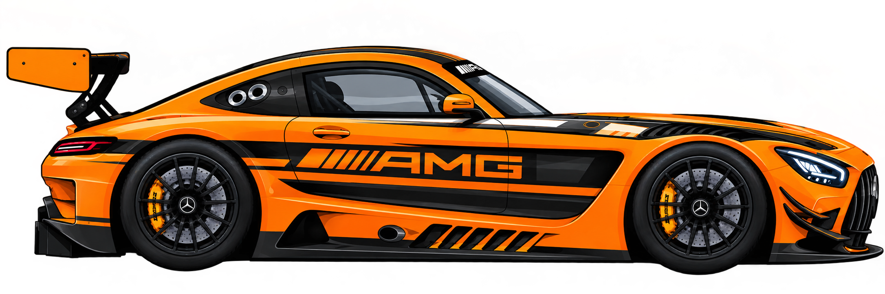

<!-- Repo à créer : nom EXACT = G-R-Alex (public). Les visuels sont dans assets/, générés par tools/generate_assets.py -->

   
   
  

  

Étudiant en MSc à Epitech (après un BUT Informatique à l'IUT Aix-Marseille).

Je m'oriente de plus en plus vers la cybersécurité : comprendre comment un système peut etre cassé pour mieux le protéger. J'apprends surtout en pratiquant : tester, casser, recommencer, avec la doc et quelques vidéos en renfort.

Hors clavier : snowboard, course auto, et jeux videos.

  

  

<!-- Ajoute ici tes autres liens quand tu veux :
[LinkedIn](https://www.linkedin.com/in/TON-PROFIL) · [Mail](mailto:ton.email@exemple.com)
-->
