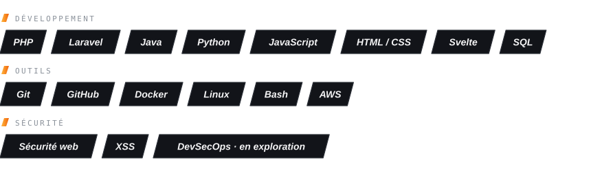
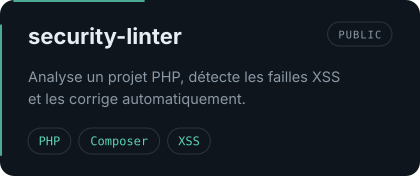
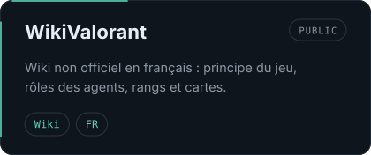
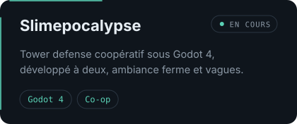
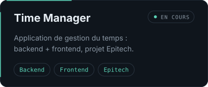

<!-- Repo à créer : nom EXACT = G-R-Alex (public). Les visuels sont dans assets/, générés par tools/generate_assets.py -->

  

  

### À propos

Étudiant en MSc à Epitech (après un BUT Informatique à l'IUT Aix-Marseille), je construis des projets concrets en web et en logiciel.

Je m'oriente de plus en plus vers la cybersécurité : comprendre comment un système casse pour mieux le protéger. Je m'entraîne sur **TryHackMe** et **Hack The Box**, et j'apprends surtout en pratiquant : tester, casser, recommencer, avec la doc et quelques vidéos en renfort.

Hors clavier : snowboard, course auto, et un peu de CS2.

### Stack

  

### Projets

  
  
  
  

### Contact

[GitHub](https://github.com/G-R-Alex)
<!-- Décommente et remplis quand tu veux :
 · [LinkedIn](https://www.linkedin.com/in/TON-PROFIL)
 · [Mail](mailto:ton.email@exemple.com)
-->
